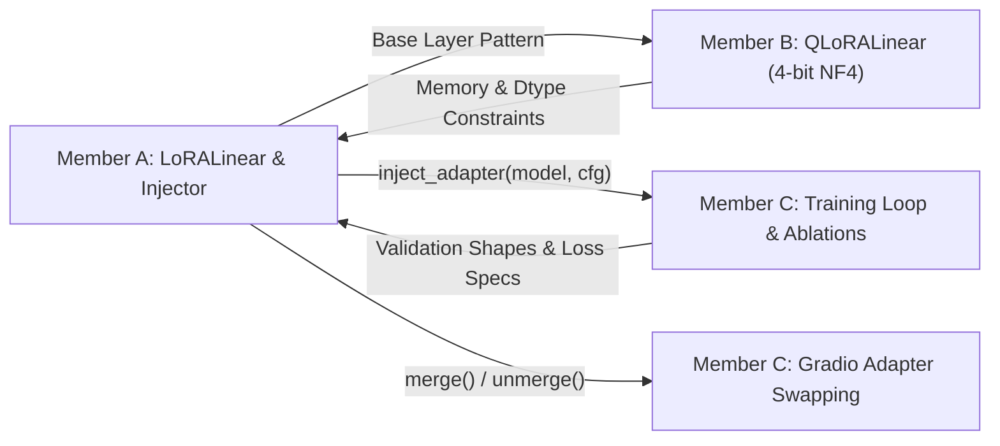

# Member A — Engineering & Research Specification
**Role:** Core Architecture & Algorithmic Foundations Lead  
**Specialization:** Mathematical Derivation, Pure PyTorch LoRA Layer, Model Injector, Dynamic Weight Merging, Parity Verification & Advanced Variant (DoRA / LoRA+)  
**Branch:** `feat/lora-core` (merging into `het`)

---

## 1. What Member A Has To Do
Member A is responsible for the theoretical core and foundational PyTorch implementations of Low-Rank Adaptation. Member A ensures the project does not rely on third-party PEFT libraries for model adaptation, but instead builds all core layers and manipulation utilities from first principles.

### Key Work Items
1. **Mathematical Derivation & Custom Layer:** Implement `LoRALinear(nn.Module)` from scratch in PyTorch.
2. **Initialization & Scaling:** Implement zero-initialization for matrix $B$, Gaussian/Kaiming initialization for matrix $A$, scaling factor $\frac{\alpha}{r}$, and adapter dropout.
3. **Dynamic Model Injector:** Implement recursive module traversal (`injector.py`) to swap specified linear modules in `GPT-2` (e.g. `c_attn`, `c_proj`) and `Qwen2.5-0.5B` (e.g. `q_proj`, `k_proj`, `v_proj`, `o_proj`, MLP linears) while freezing all base parameters.
4. **Zero-Latency Merge / Unmerge Engine:** Implement `merge()` to fold $\Delta W = \frac{\alpha}{r}BA$ in-place into base weights for zero-overhead inference, and `unmerge()` to restore base weights.
5. **Numerical Parity Unit Test Suite:** Build automated tests verifying that forward output logits and backward gradients of `LoRALinear` match Hugging Face `peft` within numerical tolerance ($\le 10^{-5}$).
6. **Advanced Variant (Week 4):** Implement **DoRA (Weight-Decomposed Low-Rank Adaptation)** or **LoRA+** (differential learning rates $\eta_B / \eta_A = \lambda$).

---

## 2. How Member A Has To Do It

### 2.1 Mathematical Formulation of `LoRALinear`
For a linear layer computing $y = x W_0^T + b$, where $W_0 \in \mathbb{R}^{d_{\text{out}} \times d_{\text{in}}}$:
- Introduce trainable low-rank matrices:
  - $A \in \mathbb{R}^{r \times d_{\text{in}}}$ (initialized as $A \sim \mathcal{N}\left(0, \frac{1}{r}\right)$ or Kaiming uniform)
  - $B \in \mathbb{R}^{d_{\text{out}} \times r}$ (initialized strictly as $B = 0$)
- In PyTorch linear layers, weights are multiplied as $x W^T$. Therefore, the low-rank delta is:
  $$\Delta W = \frac{\alpha}{r} (B \cdot A) \in \mathbb{R}^{d_{\text{out}} \times d_{\text{in}}}$$
- Forward pass computation:
  $$y = x W_0^T + \frac{\alpha}{r} \left(\text{Dropout}(x) \cdot A^T \cdot B^T\right) + b$$
- Because $B = 0$ at initialization, $\Delta W = 0$, guaranteeing that at step 0 the adapted layer produces the exact outputs of the frozen base model.

### 2.2 In-Place Merge and Unmerge Algorithm
- **`merge()`:**
  ```python
  if not self.merged:
      delta_w = (self.alpha / self.r) * (self.lora_B.weight @ self.lora_A.weight)
      self.base_layer.weight.data += delta_w
      self.merged = True
  ```
  When merged, the forward pass simplifies to $y = \text{self.base\_layer}(x)$, yielding identical latency to unadapted models.
- **`unmerge()`:**
  ```python
  if self.merged:
      delta_w = (self.alpha / self.r) * (self.lora_B.weight @ self.lora_A.weight)
      self.base_layer.weight.data -= delta_w
      self.merged = False
  ```

### 2.3 Dynamic Injection Algorithm (`injector.py`)
1. Traverse the model recursively using `named_children()`.
2. Check if a child module name matches the target list (e.g. `["q_proj", "v_proj"]` or `["c_attn"]`).
3. If matching:
   - Instantiate `LoRALinear(base_layer=child, r=r, alpha=alpha, dropout=dropout)`.
   - Replace the child using `setattr(parent, child_name, new_lora_layer)`.
4. Iterate over all parameters in the model; set `requires_grad = False` for all base weights, and `requires_grad = True` exclusively for `lora_A` and `lora_B`.

### 2.4 Parity Verification Strategy
Create a controlled synthetic test:
- Instantiate one `LoRALinear` and one Hugging Face `peft.LoraLayer` with identical dimensions ($d_{\text{in}}=64, d_{\text{out}}=128, r=4$).
- Copy weights: `peft_layer.lora_A.weight.data.copy_(custom_layer.lora_A.weight.data)` and similarly for $B$.
- Pass identical tensor $X \sim \mathcal{N}(0, 1)$ through both.
- Assert `torch.allclose(out_custom, out_peft, atol=1e-5)`.
- Compute scalar loss, execute `.backward()`, and assert `torch.allclose(grad_A_custom, grad_A_peft, atol=1e-5)`.

---

## 3. Where Member A Has To Do It

All work for Member A is housed in the following repository paths:

```
LoRA_FAI/
├── src/
│   ├── core/
│   │   ├── lora_layer.py          <-- Custom LoRALinear & LoRAConfig
│   │   ├── injector.py            <-- Recursive module injection & weight freezing
│   │   └── dora_layer.py          <-- Advanced variant (DoRA / LoRA+)
│   └── models/
│       ├── gpt2_wrapper.py        <-- Target module mapping for GPT-2 ('c_attn', etc.)
│       └── qwen_wrapper.py        <-- Target module mapping for Qwen2.5 ('q_proj', 'v_proj')
├── tests/
│   ├── test_lora_layer.py         <-- Parity assertions vs HF PEFT
│   ├── test_merge_unmerge.py      <-- Numerical stability of merge & unmerge
│   └── test_injector.py           <-- Checks correct parameter freezing & module substitution
└── scripts/
    └── run_parity_check.py        <-- Standalone script to verify correctness
```

---

## 4. How Member A's Portion Is Linked to Other Members



- **Handoff to Member B:**
  - Member B subclasses or mirrors `LoRALinear` to create `QLoRALinear`, binding low-rank adapters to `bitsandbytes` 4-bit quantized base layers.
  - Member A provides the clean tensor initialization and merge/unmerge logic that Member B tests in 4-bit precision.
- **Handoff to Member C:**
  - Member C imports `inject_lora(model, config)` inside `src/training/trainer.py` to adapt models before fine-tuning on SST-2 and Dolly-15k.
  - Member C calls `merge()` and `unmerge()` in `src/demo/app.py` to enable instant zero-overhead adapter swapping.
- **Inputs Received from Others:**
  - Receives target module names and sequence lengths from Member C's model selection.
  - Receives compute precision requirements (FP16/BF16/FP32 casting) from Member B.

---

## 5. Tech Stack for Member A

- **Primary Framework:** `torch`, `torch.nn`, `torch.nn.functional`
- **Models & Tokenizers:** `transformers` (`GPT2LMHeadModel`, `Qwen2ForCausalLM`, `AutoModelForSequenceClassification`)
- **Reference Oracle (Testing Only):** `peft` (`LoraConfig`, `get_peft_model`)
- **Testing Framework:** `pytest`
- **Typing & Validation:** `dataclasses`, `typing.Optional`, `typing.List`

---

## 6. How Member A Starts

1. **Checkout & Branch:**
   ```bash
   git checkout het
   git checkout -b feat/lora-core
   ```
2. **Environment Verification:**
   Ensure PyTorch and PEFT are installed in your virtual environment:
   ```bash
   python -c "import torch, peft, transformers; print('PyTorch:', torch.__version__, '| PEFT:', peft.__version__)"
   ```
3. **Step 1 Implementation:**
   - Create `src/core/lora_layer.py`.
   - Implement `LoRAConfig` dataclass (`r: int`, `lora_alpha: float`, `lora_dropout: float`, `target_modules: list[str]`).
   - Implement `LoRALinear(nn.Module)`.
4. **Step 2 Verification:**
   - Write `tests/test_lora_layer.py` with the parity check against `peft`.
   - Run:
     ```bash
     pytest tests/test_lora_layer.py -v
     ```
   - Must achieve green tests before moving to `injector.py`.

---

## 7. Expected Outputs & Target Results

| Deliverable | Target Metric / Result |
| :--- | :--- |
| **`LoRALinear` forward parity** | Numerical discrepancy vs HF `peft` $\le 10^{-5}$ on random inputs. |
| **Gradient parity** | $\Delta \nabla_{A}, \Delta \nabla_{B} \le 10^{-5}$ compared to HF `peft`. |
| **Parameter Freezing** | Trainable parameters $\le 1.0\%$ of total model parameters on GPT-2 and Qwen2.5. |
| **Merge Invariance** | Post-merge output must match pre-merge output with error $< 10^{-6}$. |
| **Unmerge Drift** | Reconstructed base weight difference after `unmerge()` must be $< 10^{-7}$. |
| **DoRA / LoRA+ Extension** | Functional implementation ready for Week 4 ablation comparisons. |

---

## 8. Integration Protocol

1. **Testing Gate:** All tests in `tests/test_lora_layer.py`, `tests/test_merge_unmerge.py`, and `tests/test_injector.py` must pass locally.
2. **Pull Request:** Push `feat/lora-core` and open a PR into `het`.
3. **Peer Review:** Member B reviews module structure for quantization compatibility; Member C reviews ease of injection in training scripts.
4. **Integration Merge:** Once merged into `het`, Member B pulls to build `QLoRALinear` and Member C pulls to execute training sweeps.
