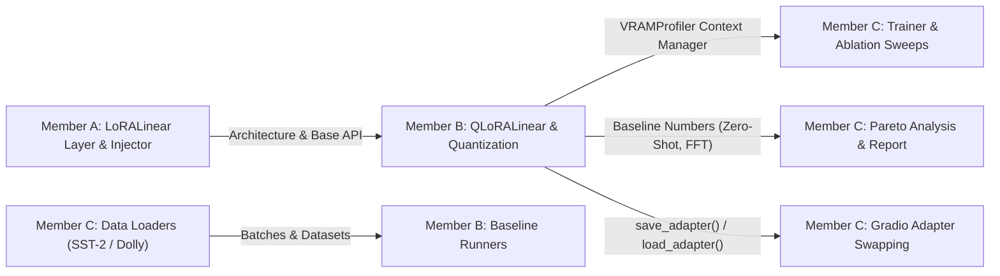

# Member B — Engineering & Research Specification
**Role:** Quantization & Advanced Systems Infrastructure Lead  
**Specialization:** 4-bit NF4 Quantization, From-Scratch `QLoRALinear`, GPU Memory & Throughput Profiler, Baselines (Zero-Shot, Head-Only, Full FT), and Adapter Checkpointing  
**Branch:** `feat/qlora-profiling` (merging into `het`)

---

## 1. What Member B Has To Do
Member B is responsible for the systems-level efficiency and memory optimization track. Member B ensures that large base models can run on a single resource-constrained GPU (NVIDIA T4 with 16 GB VRAM) by quantizing the base model to 4-bit NormalFloat (NF4), tracking precise memory consumption, running benchmark baselines, and implementing lightweight adapter serialization.

### Key Work Items
1. **NF4 Quantization Pipeline:** Integrate `bitsandbytes` 4-bit NormalFloat (NF4) quantization with double quantization and paged optimizers.
2. **From-Scratch `QLoRALinear` Layer:** Implement `QLoRALinear(nn.Module)` which wraps a 4-bit frozen `Linear4bit` base layer with 16-bit trainable low-rank adapters ($A$ and $B$).
3. **GPU Memory & Throughput Profiler:** Implement automated profiling utilities (`profiler.py`) tracking peak allocated VRAM (`torch.cuda.max_memory_allocated`), reserved memory, wall-clock time, and tokens/second.
4. **Parameter Inspection Utility:** Build tools to inspect and display model parameter counts: total, frozen, trainable, and percentage adapted ($< 1.0\%$).
5. **Baselines Benchmarking:** Execute the three comparison baselines on the single T4 GPU environment:
   - **Zero-Shot:** Evaluate base model without fine-tuning.
   - **Head-Only / Linear Probe:** Freeze all transformer layers, train only output classification/LM head.
   - **Full Fine-Tuning (FFT):** Fine-tune all parameters (upper bound for accuracy and memory).
6. **Adapter-Only Checkpointing:** Build serialization utilities that save strictly the low-rank matrices ($A$ and $B$) to disk in a compact format ($< 10\text{ MB}$), avoiding saving the multi-gigabyte base model weights.

---

## 2. How Member B Has To Do It

### 2.1 4-bit NF4 Quantization & `QLoRALinear`
- Use `bitsandbytes` to load base model linear layers in 4-bit NormalFloat format:
  ```python
  from transformers import BitsAndBytesConfig
  import bitsandbytes as bnb

  bnb_config = BitsAndBytesConfig(
      load_in_4bit=True,
      bnb_4bit_quant_type="nf4",
      bnb_4bit_compute_dtype=torch.float16,
      bnb_4bit_use_double_quant=True,
  )
  ```
- **Forward Pass of `QLoRALinear`:**
  - Base layer weights are kept in 4-bit NF4 format.
  - When an input tensor $x$ arrives, the base layer performs dequantization-on-the-fly and matrix multiplication in compute dtype (FP16 or BF16).
  - Concurrently, the FP16 LoRA branch computes the low-rank delta:
    $$y = \text{base\_layer\_4bit}(x) + \frac{\alpha}{r} \left(\text{Dropout}(x) \cdot A^T \cdot B^T\right)$$
  - Gradients are only computed and stored for $A$ and $B$, avoiding backpropagating into or storing gradients for the 4-bit base weights.

### 2.2 Memory & Latency Profiler Implementation (`profiler.py`)
- Implement a reusable context manager and wrapper:
  ```python
  class VRAMProfiler:
      def __enter__(self):
          if torch.cuda.is_available():
              torch.cuda.reset_peak_memory_stats()
              torch.cuda.synchronize()
              self.start_mem = torch.cuda.memory_allocated()
          self.start_time = time.perf_counter()
          return self

      def __exit__(self, exc_type, exc_val, exc_tb):
          if torch.cuda.is_available():
              torch.cuda.synchronize()
              self.peak_mem = torch.cuda.max_memory_allocated()
              self.allocated_gb = self.peak_mem / (1024 ** 3)
          self.elapsed_time = time.perf_counter() - self.start_time
  ```
- Collect real-time samples during training steps to detect memory spikes from activation caching or optimizer state allocations.

### 2.3 Parameter Counter Utility
- Implement a clear tabular breakdown:
  ```python
  def print_trainable_parameters(model):
      trainable_params = sum(p.numel() for p in model.parameters() if p.requires_grad)
      all_params = sum(p.numel() for p in model.parameters())
      percent = 100 * trainable_params / all_params
      print(f"Trainable: {trainable_params:,} || Total: {all_params:,} || Trainable %: {percent:.4f}%")
      return {"trainable": trainable_params, "total": all_params, "percent": percent}
  ```

### 2.4 Baseline Implementations (`baselines.py`)
1. **Zero-Shot Runner:** Pass test/validation batches through the base model without any backward pass. Compute accuracy (SST-2) or perplexity (Dolly-15k).
2. **Head-Only Runner:** Freeze all transformer backbone layers (`for param in model.transformer.parameters(): param.requires_grad = False`). Set only classification head / LM head `requires_grad = True`. Train with standard AdamW.
3. **Full Fine-Tuning Runner:** Unfreeze all weights (`requires_grad = True` everywhere). Run standard training with gradient checkpointing enabled if needed to prevent OOM on the T4 GPU. Measure peak VRAM and training time.

### 2.5 Adapter-Only Serialization (`checkpoint.py`)
- Extract only parameters containing `lora_` in their key:
  ```python
  def save_adapter(model, save_path):
      adapter_state = {k: v.cpu() for k, v in model.state_dict().items() if "lora_" in k}
      torch.save(adapter_state, save_path)
  ```
- Provide `load_adapter(model, load_path)` that restores only these low-rank weights, ensuring compatibility with the Gradio demo.

---

## 3. Where Member B Has To Do It

All work for Member B is housed in the following repository paths:

```
LoRA_FAI/
├── src/
│   ├── core/
│   │   └── qlora_layer.py         <-- Custom QLoRALinear (NF4 4-bit integration)
│   └── training/
│       ├── profiler.py            <-- VRAM, throughput, and parameter counting tools
│       ├── baselines.py           <-- Zero-Shot, Head-Only, and Full Fine-Tuning scripts
│       └── checkpoint.py          <-- Lightweight adapter saving and loading (<10MB)
├── configs/
│   ├── qlora_nf4.yaml             <-- Configuration for 4-bit QLoRA experiments
│   └── baselines.yaml             <-- Configuration for FFT and Head-Only runs
├── tests/
│   └── test_quantization.py       <-- Tests 4-bit loading, forward pass & gradient flow
└── scripts/
    └── run_baselines.py           <-- CLI entrypoint to execute baselines and log metrics
```

---

## 4. How Member B's Portion Is Linked to Other Members



- **Handoff from Member A:**
  - Member B inspects Member A's `LoRALinear` to ensure `QLoRALinear` maintains identical attribute signatures (`r`, `alpha`, `dropout`, `merged`).
- **Handoff to Member C:**
  - Member B provides `VRAMProfiler` so Member C can profile memory in the main training loop and ablation scripts.
  - Member B provides `save_adapter` / `load_adapter` so Member C's Gradio demo can load and swap small adapter checkpoints dynamically.
  - Member B provides the baseline performance ceiling (FFT accuracy/loss) and baseline floor (Zero-shot / Head-only) for Member C's Pareto graphs.
- **Inputs Received from Member C:**
  - Member B uses the SST-2 and Dolly-15k dataset loaders implemented by Member C to evaluate the baselines.

---

## 5. Tech Stack for Member B

- **Quantization:** `bitsandbytes` (`Linear4bit`, `bnb.optim.PagedAdamW8bit`)
- **Core DL:** `torch`, `torch.cuda`
- **System Profiling:** `pynvml` (NVIDIA management library), `psutil`, `time`
- **Model Loading:** `transformers` (`BitsAndBytesConfig`, `AutoModelForCausalLM`)
- **Serialization:** `torch.save`, `safetensors`

---

## 6. How Member B Starts

1. **Checkout & Branch:**
   ```bash
   git checkout het
   git checkout -b feat/qlora-profiling
   ```
2. **GPU & bitsandbytes Health Check:**
   Verify GPU visibility and 4-bit quantization support:
   ```bash
   python -c "import torch, bitsandbytes; print('CUDA Available:', torch.cuda.is_available(), '| Device:', torch.cuda.get_device_name(0) if torch.cuda.is_available() else 'None')"
   ```
3. **Step 1 Implementation:**
   - Create `src/training/profiler.py` with `VRAMProfiler` and `print_trainable_parameters()`.
   - Test it by profiling a dummy matrix multiplication on GPU.
4. **Step 2 Implementation:**
   - Create `src/training/baselines.py` and implement the Zero-Shot and Head-Only evaluation routines on GPT-2.
   - Run:
     ```bash
     python scripts/run_baselines.py --baseline zero_shot --model gpt2
     ```
5. **Step 3 Implementation:**
   - Build `src/core/qlora_layer.py` and write `tests/test_quantization.py`.

---

## 7. Expected Outputs & Target Results

| Deliverable | Target Metric / Result |
| :--- | :--- |
| **VRAM Profiler Accuracy** | Real-time memory tracking accurate to within $\pm 1\%$ of `nvidia-smi`. |
| **Full Fine-Tuning Baseline** | Quality upper bound established on SST-2 (~91–93% accuracy) with recorded peak VRAM ($> 12\text{ GB}$). |
| **Head-Only Baseline** | Quality lower bound established on SST-2 (~75–80% accuracy) with minimal training time. |
| **QLoRA VRAM Reduction** | Peak VRAM during QLoRA training on T4 GPU $\le 6.0\text{ GB}$ (representing a $> 50\%$ reduction over FP16 LoRA). |
| **Adapter Checkpoint Size** | Adapter file size $\le 10\text{ MB}$ per task (compared to $> 1\text{ GB}$ for full model). |
| **Quantization Parity Test** | Backward gradients flow correctly through adapters without error on 4-bit frozen base weights. |

---

## 8. Integration Protocol

1. **Testing Gate:** Run `tests/test_quantization.py` to ensure 4-bit base forward and adapter backward passes execute cleanly without CUDA memory leaks.
2. **Pull Request:** Push `feat/qlora-profiling` and open PR into `het`.
3. **Peer Review:** Member A verifies that `QLoRALinear` adheres to adapter interface standards; Member C verifies profiler hooks integrate cleanly into the training loop.
4. **Integration Merge:** Once merged into `het`, Member C integrates `qlora_nf4.yaml` into the master ablation and reproduction scripts.
