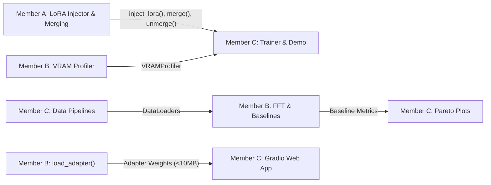

# Member C — Engineering & Research Specification
**Role:** Empirical Experiments, Hyperparameter Search & Interactive Demo Lead  
**Specialization:** Dataset Pipelines (SST-2 & Dolly-15k), Training Loop Engine, Systematic Ablation Sweeps, Optuna Pareto Frontier Mapping, Gradio Web UI, and Reproduction Scripts  
**Branch:** `feat/experiments-demo` (merging into `het`)

---

## 1. What Member C Has To Do
Member C is responsible for data engineering, the empirical training pipeline, hyperparameter exploration, multi-objective Pareto analysis, and building the interactive demonstration. Member C ensures the mathematical modules from Member A and systems utilities from Member B are driven end-to-end to generate the paper's scientific results.

### Key Work Items
1. **Dataset Pipelines:** Construct tokenization, prompt formatting, padding, and loss-masking pipelines for:
   - **GLUE SST-2:** Sentiment classification with sequence classification head.
   - **Databricks Dolly-15k:** Instruction tuning with causal language modeling and prompt-loss masking (training loss computed only on generated response tokens).
2. **Flexible Training Engine:** Implement `src/training/trainer.py` supporting mixed precision (FP16/BF16), gradient accumulation, AdamW with warmup and cosine decay, and evaluation loops.
3. **Systematic Ablation Sweeps:** Conduct empirical sweeps:
   - **Rank $r$ sensitivity:** $r \in \{1, 4, 8, 16, 64\}$.
   - **Scaling factor $\alpha$ sensitivity:** $\alpha \in \{r/2, r, 2r, 4r\}$.
   - **Target module selection:** Attention $W_q, W_v$ vs. All Attention ($W_q, W_k, W_v, W_o$) vs. All Linear / MLP layers.
4. **Pareto Frontier Optimization:** Execute multi-objective optimization using Optuna and generate publication-ready plots (Accuracy/Perplexity vs. Trainable Parameters vs. Peak VRAM).
5. **Interactive Adapter-Swapping Demo:** Develop a Gradio web application (`src/demo/app.py`) showcasing a single frozen base model dynamically swapping task adapters (SST-2 sentiment vs. Dolly-15k instruction) on the fly with zero reload overhead.
6. **Master Reproduction Pipeline:** Build `scripts/run_all_experiments.py` and a Google Colab notebook (`t4_gpu_reproduction.ipynb`) enabling one-click reproduction of all results on an NVIDIA T4 GPU.

---

## 2. How Member C Has To Do It

### 2.1 Dataset Pipelines (`src/data/`)
- **GLUE SST-2 (`sst2_dataset.py`):**
  - Load via `datasets.load_dataset("glue", "sst2")`.
  - Tokenize sentences with tokenizer padding and truncation up to `max_length=128`.
  - Return PyTorch `DataLoader` with `input_ids`, `attention_mask`, and `labels`.
- **Databricks Dolly-15k (`dolly_dataset.py`):**
  - Load via `datasets.load_dataset("databricks/databricks-dolly-15k")`.
  - Format using standard instruction template:
    ```text
    ### Instruction:
    {instruction}

    ### Context:
    {context}

    ### Response:
    {response}
    ```
  - **Prompt Masking:** In the target `labels` tensor, set all tokens preceding `### Response:` to `-100` so cross-entropy loss is computed exclusively on the model's generated response tokens.

### 2.2 Training Engine (`src/training/trainer.py`)
- Encapsulate the core training loop:
  - Integrate Member A's `injector.py` to adapt the model before training starts.
  - Wrap steps with Member B's `VRAMProfiler` to monitor memory usage per epoch.
  - Support automatic mixed precision using `torch.cuda.amp.autocast()`.
  - Log loss, learning rate, and VRAM directly to `wandb` or TensorBoard.

### 2.3 Systematic Ablation Runner (`scripts/run_ablations.py`)
- Read sweep definitions from `configs/ablation_grid.yaml`:
  ```python
  ranks = [1, 4, 8, 16, 64]
  target_configs = {
      "qv_only": ["q_proj", "v_proj"],
      "all_attn": ["q_proj", "k_proj", "v_proj", "o_proj"],
      "all_linear": ["q_proj", "k_proj", "v_proj", "o_proj", "gate_proj", "up_proj", "down_proj"]
  }
  ```
- Iterate deterministically with a fixed random seed (`seed=42`), record validation metrics and memory profiles, and output results to a structured `results/ablations.json`.

### 2.4 Pareto Frontier Analysis (`src/evaluation/pareto.py`)
- Use Pareto dominance criteria:
  A configuration $A$ dominates configuration $B$ if $A$ is better than or equal to $B$ in all metrics (higher accuracy, lower trainable parameters, lower peak VRAM, lower training time) and strictly better in at least one metric.
- Generate high-resolution Seaborn/Matplotlib plots highlighting the Pareto-optimal frontier.

### 2.5 Gradio Adapter-Swapping Demo (`src/demo/app.py`)
- Architecture:
  1. Load the frozen base model (e.g. `Qwen2.5-0.5B` or `GPT-2`) into GPU memory **once**.
  2. Maintain a registry of saved adapter checkpoints:
     - `adapters/sst2_sentiment.pt`
     - `adapters/dolly_instruction.pt`
  3. When the user selects an adapter from the Gradio UI dropdown:
     - Call `unmerge()` on the active adapter (if merged).
     - Load the selected adapter weights via Member B's `load_adapter()`.
     - Call `merge()` to fold the adapter into base weights.
     - Execute text generation or classification in real time with zero switching latency.

---

## 3. Where Member C Has To Do It

All work for Member C is housed in the following repository paths:

```
LoRA_FAI/
├── src/
│   ├── data/
│   │   ├── sst2_dataset.py        <-- GLUE SST-2 tokenization and collator
│   │   └── dolly_dataset.py       <-- Dolly-15k instruction formatting and label masking
│   ├── training/
│   │   └── trainer.py             <-- Unified PyTorch training loop & eval engine
│   ├── evaluation/
│   │   ├── metrics.py             <-- Accuracy, F1, Perplexity calculations
│   │   └── pareto.py              <-- Pareto frontier computation & visualization
│   └── demo/
│       └── app.py                 <-- Gradio live adapter-swapping application
├── configs/
│   ├── sst2_lora.yaml             <-- Default SST-2 LoRA training parameters
│   ├── dolly_lora.yaml            <-- Dolly-15k instruction tuning parameters
│   └── ablation_grid.yaml         <-- Matrix for rank, alpha, and module sweeps
├── scripts/
│   ├── run_ablations.py           <-- Automated ablation sweep script
│   └── run_all_experiments.py     <-- Master reproduction script
└── notebooks/
    └── t4_gpu_reproduction.ipynb  <-- End-to-end executable Colab notebook
```

---

## 4. How Member C's Portion Is Linked to Other Members



- **Handoff from Member A:**
  - Member C imports `inject_lora` to attach low-rank adapters to the base model.
  - Member C calls `merge()` and `unmerge()` in the Gradio demo to execute instant adapter swaps.
- **Handoff from Member B:**
  - Member C embeds Member B's `VRAMProfiler` into the training loop to capture peak memory for every ablation run.
  - Member C incorporates Member B's baseline metrics (Zero-shot, FFT, Head-only) into the final Pareto charts.
  - Member C uses Member B's adapter checkpoint format to load saved weights in the demo.
- **Handoff to Member A & B:**
  - Member C provides ready-to-use `DataLoader` objects so Members A and B can test layer forward passes on real token batches.
  - Member C produces the final visual charts, tables, and demo video for the team paper.

---

## 5. Tech Stack for Member C

- **Data Loading:** `datasets`, `transformers`
- **Training Engine:** `torch`, `torch.optim` (`AdamW`), `torch.cuda.amp`
- **Optimization & Evaluation:** `optuna`, `scikit-learn`, `evaluate`, `scipy`
- **Visualization:** `matplotlib`, `seaborn`, `wandb`
- **Interactive UI:** `gradio`
- **Execution Platform:** Google Colab / Kaggle with NVIDIA T4 GPU

---

## 6. How Member C Starts

1. **Checkout & Branch:**
   ```bash
   git checkout het
   git checkout -b feat/experiments-demo
   ```
2. **Dataset Setup:**
   Download and verify small samples of SST-2 and Dolly-15k:
   ```bash
   python -c "from datasets import load_dataset; d1 = load_dataset('glue', 'sst2', split='train[:100]'); d2 = load_dataset('databricks/databricks-dolly-15k', split='train[:100]'); print('SST-2:', len(d1), '| Dolly:', len(d2))"
   ```
3. **Step 1 Implementation:**
   - Implement `src/data/sst2_dataset.py` and `src/data/dolly_dataset.py`.
   - Write unit tests ensuring token tensors and attention masks have expected shapes.
4. **Step 2 Implementation:**
   - Implement `src/training/trainer.py` skeleton with standard training loop.
   - Run a 1-epoch test run on SST-2 with dummy adapter injection.
5. **Step 3 Implementation:**
   - Build `scripts/run_ablations.py` to automate rank sweeps ($r=1, 4, 8, 16, 64$).
   - Implement `src/demo/app.py` for Gradio UI.

---

## 7. Expected Outputs & Target Results

| Deliverable | Target Metric / Result |
| :--- | :--- |
| **SST-2 LoRA Accuracy** | Reach $\ge 95\%–99\%$ of Full Fine-Tuning accuracy on SST-2 ($\approx 90\%–92\%$). |
| **Dolly-15k Quality** | Perplexity drops consistently over epochs with coherent instruction-following generation. |
| **Ablation Matrix** | Complete empirical matrix across 5 ranks ($r=1, 4, 8, 16, 64$) and 3 module setups, showing rank saturation. |
| **Pareto Frontier Plot** | Publication-grade Pareto plot (PDF/PNG) showing accuracy vs. parameter efficiency and memory trade-offs. |
| **Gradio Web Demo** | Responsive web interface loading adapters and generating responses in $< 500\text{ ms}$ switching latency. |
| **One-Click Reproduction** | `scripts/run_all_experiments.py` reproduces full experiment suite deterministically under fixed seeds. |

---

## 8. Integration Protocol

1. **Testing Gate:** Verify data loaders produce correct shapes and prompt-masking labels; verify Gradio app launches without error.
2. **Pull Request:** Push `feat/experiments-demo` and open PR into `het`.
3. **Peer Review:** Member A reviews adapter injection and merge calls in the trainer and demo; Member B reviews VRAM logging and checkpoint format compatibility.
4. **Master Integration:** Once merged into `het`, all three members run `scripts/run_all_experiments.py` end-to-end to assemble the final paper results.
