# Efficient Adaptation of Large Language Models: A From-Scratch Implementation and Analysis of LoRA and QLoRA

[](https://github.com/)
[-red.svg)](https://arxiv.org/abs/2106.09685)
[-orange.svg)](https://arxiv.org/abs/2305.14314)
[](https://www.python.org/)
[](https://pytorch.org/)
[](LICENSE)

---

## 1. Project Overview & Research Motivation

Modern Large Language Models (LLMs) such as GPT-2 and Qwen2.5 achieve state-of-the-art performance across diverse natural language processing tasks. However, adapting these models via **Full Fine-Tuning (FFT)** requires updating all model parameters. For billion-parameter models, this demands prohibitive GPU memory for activations, gradients, and optimizer states (often 3×–4× the model weights in AdamW), and outputs multi-gigabyte checkpoints for every downstream task.

This project belongs to the **Research Implementation Track**. Rather than treating Parameter-Efficient Fine-Tuning (PEFT) as a black-box API, our central objective is to **reproduce and evaluate Low-Rank Adaptation (LoRA) and Quantized Low-Rank Adaptation (QLoRA) from first mathematical principles** in pure PyTorch.

### Core Mathematical Formulation
For a pretrained frozen weight matrix $W_0 \in \mathbb{R}^{d \times k}$, LoRA decomposes the weight update $\Delta W$ into the product of two low-rank matrices:

$$\Delta W = \frac{\alpha}{r} (B \cdot A)$$

where:
- $B \in \mathbb{R}^{d \times r}$ is initialized to zero ($B = 0$).
- $A \in \mathbb{R}^{r \times k}$ is initialized with Gaussian noise $\mathcal{N}(0, \sigma^2)$ (or Kaiming uniform).
- $r \ll \min(d, k)$ is the intrinsic adaptation rank.
- $\alpha$ is a constant scaling hyperparameter.

The modified forward pass computes:
$$h = W_0 x + \Delta W x = W_0 x + \frac{\alpha}{r} B A x$$

Because $B = 0$ at step $0$, the adapted model begins exactly at the base model state ($\Delta W = 0$). At deployment, the update can be directly folded back into the base weights:
$$W_{\text{merged}} = W_0 + \frac{\alpha}{r} B A$$
This achieves zero added inference latency and zero memory overhead at test time.

---

## 2. Product Requirements Document (PRD) & Research Specification

### 2.1 Scope & Core Objectives
1. **From-Scratch Implementation:**
   - Develop custom `LoRALinear` layers in PyTorch without depending on `peft` for core adaptation logic.
   - Implement zero-overhead dynamic weight merge ($W \leftarrow W + \Delta W$) and unmerge operations.
   - Implement a model injector that dynamically traverses transformer architectures (`GPT-2` and `Qwen2.5-0.5B`), freezes base weights, and swaps specified linear layers with `LoRALinear`.
2. **Correctness & Parity Verification:**
   - Establish unit test parity checking outputs, loss trajectories, and gradient steps against Hugging Face `peft` within strict numerical tolerance ($\le 10^{-5}$).
3. **Baselines Benchmarking:**
   - Benchmark against **Zero-Shot**, **Head-Only Fine-Tuning** (linear probe lower bound), and **Full Fine-Tuning** (quality upper bound).
4. **QLoRA Integration (4-bit NF4):**
   - Implement custom quantized adapter layers using 4-bit NormalFloat (NF4) base weights via `bitsandbytes`, enabling training on a single free-tier NVIDIA T4 GPU (16 GB VRAM).
5. **Ablation Studies & Pareto Frontier Analysis:**
   - Systematically ablate rank $r \in \{1, 4, 8, 16, 64\}$, scaling $\alpha$, target modules (Attention Q/V vs. All Attention vs. MLP), and learning rates.
   - Map the Pareto frontier across **Task Accuracy / F1 / Perplexity**, **Trainable Parameters**, **Peak GPU VRAM**, and **Wall-Clock Training Time**.
6. **Advanced Extension:**
   - Implement and evaluate **DoRA (Weight-Decomposed Low-Rank Adaptation)** or **LoRA+** (differential learning rates $lr_B / lr_A = \lambda$).
7. **Interactive Artifact:**
   - Build a Gradio web application demonstrating multi-adapter swapping on a shared frozen base model without reloading base weights.

### 2.2 PEAS Framework Specification

| PEAS Element | Formal Specification |
| :--- | :--- |
| **Performance Measure** | • Task Accuracy / F1 (SST-2) and Perplexity (Dolly-15k)<br>• Trainable parameter count & percentage of total ($< 1\% target$)<br>• Peak GPU memory utilization (GB via `torch.cuda.max_memory_allocated`)<br>• Training wall-clock time and throughput (samples/sec)<br>• Saved adapter checkpoint artifact size (MB) |
| **Environment** | • Pretrained Models: `Qwen2.5-0.5B` and `GPT-2`<br>• Downstream Datasets: GLUE SST-2 (Classification) & Databricks Dolly-15k (Instruction)<br>• Hardware Constraint: Single NVIDIA T4 GPU (Google Colab / Kaggle 15–16 GB VRAM)<br>• Environment: Static, fully observable, single-agent, deterministic under fixed seeds |
| **Actuators** | • Rank $r$, scaling factor $\alpha$, adapter dropout $p$<br>• Target module selection ($W_q, W_v$ vs. $W_q, W_k, W_v, W_o$ vs. MLP)<br>• Base precision (16-bit FP16/BF16 vs. 4-bit NF4)<br>• Learning rate schedule, batch size, gradient accumulation steps<br>• Weight merge / unmerge operations |
| **Sensors** | • Cross-entropy loss and validation loss curves<br>• GPU memory profiler (`torch.cuda.memory_stats`, `pynvml`)<br>• Epoch/step wall-clock timer and parameter inspect tool |

### 2.3 Formulation Details
- **Initial State:** Pretrained base model with all weights frozen; adapters attached with $B = 0$ such that initial loss is numerically identical to zero-shot base model.
- **Action Set:** Configuration selection $(r, \alpha, \text{targets}, \text{lr}, \text{precision})$, training execution on downstream dataset, and adapter weight serialization.
- **Goal State:** Reach $\ge 95\%–99\%$ of Full Fine-Tuning accuracy on SST-2 while training $\le 1\%$ of parameters and maintaining peak VRAM under 8 GB on a T4 GPU.
- **Cost Metric:** Multidimensional Pareto score balancing parameter count, memory footprint, training wall-clock time, and accuracy gap.

---

## 3. Technology Stack & Tooling

| Domain | Library / Tool | Version | Purpose & Rationale |
| :--- | :--- | :--- | :--- |
| **Language** | Python | 3.10+ | Standard typing support, pattern matching, robust deep learning ecosystem |
| **Core DL Engine** | PyTorch | $\ge 2.2.0$ | Primary tensor library; building custom `nn.Module` classes, backward hooks, and memory tracking |
| **Model Architectures** | Hugging Face `transformers` | $\ge 4.40.0$ | Downloading and instantiating `Qwen2.5-0.5B` and `GPT-2` base models and tokenizers |
| **Datasets & Prep** | Hugging Face `datasets` | $\ge 2.18.0$ | Fast loading and streaming of GLUE SST-2 and Databricks Dolly-15k |
| **Quantization** | `bitsandbytes` | $\ge 0.43.0$ | 4-bit NormalFloat (NF4) quantization, double quantization, and 8-bit/paged optimizers for QLoRA |
| **Reference Validation** | Hugging Face `peft` | $\ge 0.10.0$ | *Strictly used as an external ground-truth oracle* for unit testing mathematical and gradient parity |
| **Evaluation Metrics** | `scikit-learn`, `evaluate` | Latest | Computing Accuracy, F1 score, Perplexity, and confusion matrices |
| **Experiment Tracking** | Weights & Biases (`wandb`), TensorBoard | Latest | Real-time logging of loss curves, VRAM spikes, hyperparameter sweeps, and gradient norms |
| **Hyperparameter Search**| `optuna` | $\ge 3.6.0$ | Bayesian optimization to map the Pareto frontier between accuracy, rank, and memory |
| **Interactive Demo** | `gradio` | $\ge 4.26.0$ | Lightweight web UI for demonstrating live adapter swapping on a single shared base model |
| **Hardware Environment**| Google Colab / Kaggle | T4 GPU | 16 GB VRAM constraint representative of accessible academic/startup compute |
| **Testing & CI** | `pytest`, `ruff`, `black` | Latest | Automated testing of layer mathematics, merge invariance, and code formatting |

---

## 4. Team Work Distribution (3 Members)

To ensure clear ownership, accountability, and smooth parallel progress over the 5-week schedule, the project is structured across three core specialization tracks:

```mermaid
flowchart TD
    subgraph TrackA["Member A: Core Architecture & Algorithmic Foundations"]
        A1["LoRALinear from Scratch"] --> A2["Model Injector & Weight Freezing"]
        A2 --> A3["Merge & Unmerge Logic"]
        A3 --> A4["HF PEFT Parity Test Suite"]
        A4 --> A5["Advanced Variant: DoRA / LoRA+"]
    end

    subgraph TrackB["Member B: Quantization & Systems Infrastructure"]
        B1["bitsandbytes NF4 4-bit Integration"] --> B2["Custom QLoRALinear Layer"]
        B2 --> B3["VRAM & Latency Profiling Suite"]
        B3 --> B4["Baselines: Zero-Shot, Head-Only, Full FT"]
        B4 --> B5["Adapter Serialization (<10MB)"]
    end

    subgraph TrackC["Member C: Empirical Experiments & Interactive Demo"]
        C1["Data Pipelines (SST-2 & Dolly-15k)"] --> C2["Ablation Sweeps (Rank, Alpha, Modules)"]
        C2 --> C3["Optuna Pareto Frontier Mapping"]
        C3 --> C4["Gradio Dynamic Adapter-Swapping Demo"]
        C4 --> C5["Results Visualization & Report Lead"]
    end

    TrackA --> Integration["Unified Evaluation & Scientific Paper"]
    TrackB --> Integration
    TrackC --> Integration
```



### Member A: Core Architecture & Algorithmic Foundations
- **Primary Focus:** Mathematical correctness, custom layers, module injection, and advanced LoRA extensions.
- **Key Responsibilities:**
  1. **From-Scratch Layer Implementation:** Implement `LoRALinear` in pure PyTorch inheriting from `nn.Module`. Support forward pass $W_0 x + \frac{\alpha}{r}BAx$, dropout, and proper parameter initialization ($B = 0$, $A \sim \mathcal{N}(0, \sigma^2)$).
  2. **Model Injector Pipeline:** Create dynamic module discovery and recursive replacement logic (`injector.py`) targeting linear projections (e.g., `c_attn`, `q_proj`, `v_proj`) while freezing all other model weights.
  3. **Zero-Latency Merge / Unmerge:** Implement numerically stable `merge()` and `unmerge()` methods that mutate the underlying base weight in-place and guarantee zero runtime latency during inference.
  4. **Parity Test Suite:** Write comprehensive `pytest` suites comparing custom LoRA output logits, cross-entropy loss, and parameter gradients against Hugging Face `peft` across randomized inputs.
  5. **Advanced Variant:** Implement **DoRA (Weight-Decomposed Low-Rank Adaptation)** or **LoRA+** (differential learning rates $\eta_B = \lambda \cdot \eta_A$) for the week 4 algorithmic expansion.

### Member B: Quantization & Systems Infrastructure
- **Primary Focus:** QLoRA 4-bit integration, systems-level memory profiler, efficiency baselines, and serialization.
- **Key Responsibilities:**
  1. **QLoRA from Scratch:** Build `QLoRALinear` integrating `bitsandbytes` 4-bit NormalFloat (NF4) base linear weights with our custom floating-point LoRA adapters.
  2. **Systems Profiling Suite:** Implement real-time GPU profilers measuring:
     - Peak allocated memory (`torch.cuda.max_memory_allocated()`)
     - Reserved VRAM and memory breakdown (weights vs. activations vs. optimizer states)
     - Training wall-clock time and throughput (tokens/sec)
  3. **Baselines Implementation:** Set up and run the foundational baselines:
     - *Zero-Shot Evaluation* (unadapted base model performance)
     - *Head-Only / Linear Probe* (freezing backbone, training only classification/LM head)
     - *Full Fine-Tuning (FFT)* (upper quality bound and memory consumption benchmark)
  4. **Lightweight Checkpointing:** Build an adapter-only serialization manager that extracts and saves solely the trained $A$ and $B$ low-rank matrices (< 10 MB per task), avoiding saving duplicate multi-gigabyte base checkpoints.

### Member C: Empirical Experiments, Hyperparameter Search & Interactive Demo
- **Primary Focus:** Dataset pipelines, systematic ablations, Pareto multi-objective optimization, and interactive deployment.
- **Key Responsibilities:**
  1. **Dataset Pipelines:** Construct tokenization, batching, and evaluation data loaders for:
     - **GLUE SST-2:** Binary sentiment classification task.
     - **Databricks Dolly-15k:** Instruction-tuning prompt formatting and target masking.
  2. **Systematic Ablation Sweeps:** Design and execute grid/automated ablation runs:
     - Rank sensitivity: $r \in \{1, 4, 8, 16, 64\}$
     - Scaling factor sensitivity: $\alpha \in \{r/2, r, 2r, 4r\}$
     - Target module configurations: Attention $W_q, W_v$ vs. All Attention vs. All Linear/MLP layers.
  3. **Pareto Frontier Optimization:** Utilize Optuna and Matplotlib/Seaborn to generate multi-metric Pareto curves (Accuracy vs. Trainable Parameters, Accuracy vs. Peak VRAM).
  4. **Interactive Adapter-Swapping Demo:** Develop a Gradio web application hosting a single frozen base model that dynamically swaps task adapters (e.g., SST-2 sentiment analyzer vs. Dolly-15k instruction follower) on the fly without model reloading.

### Shared Team Responsibilities
- **Weekly Code Review:** Cross-review PRs before merging into `main`.
- **Reproducibility Guarantee:** Jointly maintain a master run script (`scripts/run_all_experiments.py`) and a Google Colab notebook for one-click reproduction on a T4 GPU.
- **Final Research Report:** Collaborative write-up contrasting experimental findings against the published Hu et al. and Dettmers et al. papers.

---

## 5. Five-Week Project Roadmap

```
Week 1 ──► Week 2 ──► Week 3 ──► Week 4 ──► Week 5
Math &     Task FT &    Ablations &   QLoRA &       Pareto &
Core LoRA  Parity       Baselines     Variants      Demo Launch
```

| Week | Milestone & Objectives | Deliverables | Responsible |
| :---: | :--- | :--- | :---: |
| **Week 1** | **Mathematical Derivation & Core Layer**<br>• Study Hu et al. (2022) mathematical formulation.<br>• Implement `LoRALinear` from scratch.<br>• Build recursive model injector and weight freezer.<br>• Verify parameter counts: confirm $< 1\%$ trainable params. | • `src/core/lora_layer.py`<br>• `src/core/injector.py`<br>• Unit tests verifying parameter freezing | Member A (Lead)<br>Member B<br>Member C |
| **Week 2** | **Task Adaptation & Parity Verification**<br>• Setup SST-2 and Dolly-15k data pipelines.<br>• Train custom LoRA on SST-2 and Dolly-15k.<br>• Implement `merge()` and `unmerge()`.<br>• Parity check: Verify loss & outputs match HF `peft`. | • `src/data/`<br>• `tests/test_lora_parity.py`<br>• `tests/test_merge_unmerge.py`<br>• Verified parity report | Member A<br>Member B<br>Member C (Lead) |
| **Week 3** | **Baselines & Systematic Ablations**<br>• Run Zero-Shot, Head-Only, and Full Fine-Tuning baselines.<br>• Run rank sweeps ($r \in \{1, 4, 8, 16, 64\}$).<br>• Run target module ablations (Q/V vs. All Attention vs. MLP).<br>• Build GPU memory & time profiling scripts. | • `src/training/baselines.py`<br>• `scripts/run_ablations.py`<br>• Ablation loss & accuracy tables | Member B (Baselines)<br>Member C (Ablations)<br>Member A (Support) |
| **Week 4** | **QLoRA & Advanced Extensions**<br>• Integrate `bitsandbytes` 4-bit NF4 base quantization.<br>• Implement custom `QLoRALinear` layer.<br>• Implement DoRA or LoRA+ variant.<br>• Benchmark memory reduction (16-bit vs 4-bit) on T4 GPU. | • `src/core/qlora_layer.py`<br>• `src/core/dora_layer.py`<br>• VRAM savings comparative benchmark | Member B (QLoRA Lead)<br>Member A (DoRA Lead)<br>Member C (Data/Eval) |
| **Week 5** | **Pareto Analysis, Demo & Final Report**<br>• Compute and plot Pareto frontier curves.<br>• Build and deploy Gradio adapter-swapping demo.<br>• Assemble master reproduction script (`run_all_experiments.py`).<br>• Complete comprehensive research report. | • `src/evaluation/pareto.py`<br>• `src/demo/app.py`<br>• Final Research Paper / Report<br>• Master reproduction notebook | Member C (Demo/Plots)<br>All Members (Final Report) |

---

## 6. Repository Architecture & Directory Structure

```
LoRA_FAI/
├── .gitignore                      # Git ignore patterns for DL checkpoints, caches, and logs
├── README.md                       # Comprehensive Project PRD, Tech Stack, & Distribution
├── requirements.txt                # Pinned production dependencies
├── setup.py                        # Local package setup (pip install -e .)
├── configs/                        # Experiment configurations
│   ├── default.yaml                # Base training configuration
│   ├── sst2_lora.yaml              # SST-2 LoRA training parameters
│   ├── dolly_lora.yaml             # Dolly-15k instruction tuning parameters
│   ├── qlora_nf4.yaml              # 4-bit QLoRA configuration
│   └── ablation_grid.yaml          # Hyperparameter sweep configurations
├── src/                            # Source implementation package
│   ├── __init__.py
│   ├── core/                       # Core mathematical layers & module manipulation
│   │   ├── __init__.py
│   │   ├── lora_layer.py           # From-scratch PyTorch LoRALinear implementation
│   │   ├── qlora_layer.py          # Custom 4-bit NF4 quantized LoRA layer
│   │   ├── dora_layer.py           # Advanced variant (DoRA / LoRA+)
│   │   └── injector.py             # Recursive module injection and weight freezing
│   ├── models/                     # Base model wrappers and target mapping
│   │   ├── __init__.py
│   │   ├── base_wrapper.py         # Abstract model wrapper
│   │   ├── gpt2_wrapper.py         # GPT-2 module target mappings
│   │   └── qwen_wrapper.py         # Qwen2.5-0.5B module target mappings
│   ├── data/                       # Dataset loaders and formatting pipelines
│   │   ├── __init__.py
│   │   ├── sst2_dataset.py         # GLUE SST-2 classification pipeline
│   │   └── dolly_dataset.py        # Databricks Dolly-15k instruction prompt formatter
│   ├── training/                   # Training engine, baselines, and profilers
│   │   ├── __init__.py
│   │   ├── trainer.py              # Custom training loop with mixed precision & gradient accumulation
│   │   ├── baselines.py            # Full Fine-Tuning, Head-Only, and Zero-Shot routines
│   │   └── profiler.py             # CUDA VRAM, throughput, and parameter counting tools
│   ├── evaluation/                 # Metrics and Pareto frontier analysis
│   │   ├── __init__.py
│   │   ├── metrics.py              # Accuracy, F1, Perplexity calculation
│   │   └── pareto.py               # Pareto frontier computation and plotting
│   └── demo/                       # Interactive user interface
│       ├── __init__.py
│       └── app.py                  # Gradio adapter-swapping web application
├── tests/                          # Automated unit test suite
│   ├── test_lora_layer.py          # Output and gradient parity check vs Hugging Face PEFT
│   ├── test_merge_unmerge.py       # Weight merge mathematical invariance tests
│   ├── test_injector.py            # Module replacement & parameter freezing validation
│   └── test_quantization.py        # NF4 4-bit forward/backward verification
├── scripts/                        # Automation and execution scripts
│   ├── run_parity_check.py         # Parity validation runner
│   ├── run_baselines.py            # Baseline execution script
│   ├── run_ablations.py            # Hyperparameter sweep runner
│   └── run_all_experiments.py      # Master reproduction pipeline
└── notebooks/                      # Exploratory and execution notebooks
    └── t4_gpu_reproduction.ipynb   # Complete execution notebook for Google Colab / Kaggle
```

---

## 7. Git Branching Strategy & Workflow

This repository follows a structured feature-branch workflow to maintain stability on `main` while enabling rapid, unblocked development on `het`:

- **`main` Branch:**
  - Production-ready, peer-reviewed codebase.
  - Contains completed milestone releases (Week 1–5 checkpoints).
  - Direct pushes are restricted; changes must arrive via reviewed pull requests.
- **`het` Branch (Active Development):**
  - Primary working branch for integration and initial implementation.
  - Active sprint branch where components from Members A, B, and C are unified and validated.
- **Feature Branches (`feat/<feature-name>`):**
  - `feat/lora-layer`: From-scratch `LoRALinear` module and injector (Member A).
  - `feat/baselines-profiling`: VRAM profiler and baseline runners (Member B).
  - `feat/data-pipelines`: SST-2 and Dolly-15k data loaders (Member C).
  - `feat/qlora-nf4`: 4-bit `bitsandbytes` adaptation (Member B).
  - `feat/gradio-demo`: Adapter swapping interactive UI (Member C).

---

## 8. Quick Start & Execution Guide

### 8.1 Installation
```bash
# Clone the repository and switch to the development branch
git clone https://github.com/<org>/LoRA_FAI.git
cd LoRA_FAI
git checkout het

# Create and activate a virtual environment
python -m venv venv
# Linux / macOS:
source venv/bin/activate
# Windows:
.\venv\Scripts\Activate.ps1

# Install package and dependencies
pip install -r requirements.txt
pip install -e .
```

### 8.2 Run Mathematical Parity Tests
Verify that the custom `LoRALinear` matches Hugging Face `peft` within numerical tolerance:
```bash
pytest tests/test_lora_layer.py -v
```

### 8.3 Run Baseline & LoRA Training
```bash
# Train LoRA on SST-2 using default configuration
python scripts/run_experiments.py --config configs/sst2_lora.yaml

# Run 4-bit QLoRA on a single T4 GPU
python scripts/run_experiments.py --config configs/qlora_nf4.yaml
```

### 8.4 Launch Interactive Adapter-Swapping Demo
```bash
python -m src.demo.app
```

---

## 9. References

1. **Hu, E. J., Shen, Y., Wallis, P., Allen-Zhu, Z., Li, Y., Wang, S., Wang, L., & Chen, W. (2022).** *LoRA: Low-Rank Adaptation of Large Language Models.* International Conference on Learning Representations (ICLR). [arXiv:2106.09685](https://arxiv.org/abs/2106.09685).
2. **Dettmers, T., Pagnoni, A., Holtzman, A., & Zettlemoyer, L. (2023).** *QLoRA: Efficient Finetuning of Quantized LLMs.* Advances in Neural Information Processing Systems (NeurIPS), 36. [arXiv:2305.14314](https://arxiv.org/abs/2305.14314).
3. **Liu, S., et al. (2024).** *DoRA: Weight-Decomposed Low-Rank Adaptation.* [arXiv:2402.09353](https://arxiv.org/abs/2402.09353).
4. **Hayou, S., et al. (2024).** *LoRA+: Efficient Low Rank Adaptation of Large Models.* [arXiv:2402.12354](https://arxiv.org/abs/2402.12354).
